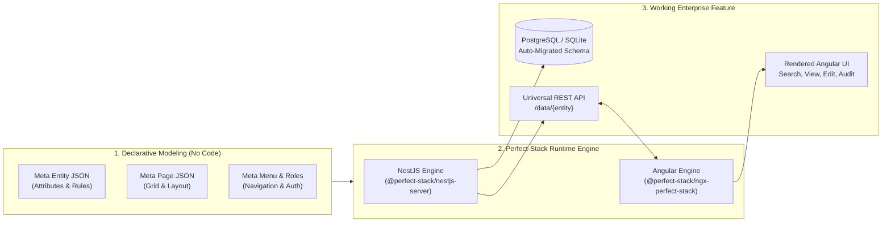

# Perfect-Stack Development Guide

> **Developer Onboarding Guide**: This guide is designed for developers who are joining an existing project powered by **Perfect-Stack**. It assumes your application environment is already running and configured. Rather than walking through blank-slate setup tutorials, this guide explains how the framework thinks, summarizes its major capabilities, and provides practical techniques for building and extending business features using both declarative metadata and custom code.
> 
> *Companion Reading*: For system internals, monorepo layout, and low-level subsystem topologies, see [`Architecture.md`](file:///Users/richardperfect/dev/perfect-consulting/perfect-stack/docs/Architecture.md).

---

## 1. The Perfect-Stack Paradigm

Traditional enterprise web development spends roughly 70–80% of its engineering effort writing boilerplate: database migrations, DTOs, CRUD endpoints, query builders, search pages, form components, validation logic, and foreign-key dropdown pickers.

**Perfect-Stack flips this paradigm.** 

Instead of writing repetitive code for each domain entity:
1. **You declare what the data looks like** in a **Meta Entity** (attributes, types, rules, relationships).
2. **You declare how users interact with it** in a **Meta Page** (layouts, templates, grid cells, controls).
3. **The framework handles the rest**:
   - The backend dynamically generates database tables, foreign keys, timestamps, indexes, and exposes generic REST endpoints.
   - The frontend dynamically renders reactive forms, search filters, paginated tables, typeaheads, and child-entity lists.



### The 80 / 20 Development Rule
- **The 80% (Standard Business Domain)**: Modeled entirely using declarative metadata. Zero lines of boilerplate code required.
- **The 20% (Custom Business Logic & Workflows)**: Implemented using standard NestJS controllers/services and Angular components, effortlessly integrating with Perfect-Stack's universal [`DataService`](file:///Users/richardperfect/dev/perfect-consulting/perfect-stack/nestjs-server/libs/nestjs-server/src/data/data.service.ts), [`QueryService`](file:///Users/richardperfect/dev/perfect-consulting/perfect-stack/nestjs-server/libs/nestjs-server/src/data/query.service.ts), and UI widgets.

---

## 2. Summary of Core Features

| Feature Area | Key Capabilities | Primary Locations & Artifacts |
| :--- | :--- | :--- |
| **Dynamic Data Modeling** | Declarative entities, typed attributes, primary keys, timestamps, audit fields, soft/permanent delete flags, cache TTL. | `meta/entities/*.json`<br/>[`MetaEntityService`](file:///Users/richardperfect/dev/perfect-consulting/perfect-stack/nestjs-server/libs/nestjs-server/src/meta/meta-entity/meta-entity.service.ts) |
| **Automatic Schema Management** | Generates database tables, columns, indexes, and foreign keys at startup without writing manual SQL migrations. | [`OrmService`](file:///Users/richardperfect/dev/perfect-consulting/perfect-stack/nestjs-server/libs/nestjs-server/src/orm/orm.service.ts)<br/>[`KnexModule`](file:///Users/richardperfect/dev/perfect-consulting/perfect-stack/nestjs-server/libs/nestjs-server/src/knex/knex.module.ts) |
| **Universal CRUD & REST API** | Uniform endpoints (`/data/{entity}`, `/data/{entity}/{id}`) for standard create, read, update, delete, batching, and cascaded child lifecycle operations. | [`DataController`](file:///Users/richardperfect/dev/perfect-consulting/perfect-stack/nestjs-server/libs/nestjs-server/src/data/data.controller.ts)<br/>[`DataService`](file:///Users/richardperfect/dev/perfect-consulting/perfect-stack/nestjs-server/libs/nestjs-server/src/data/data.service.ts) |
| **Advanced Query & Search Engine** | Multi-criteria search, depth-bounded includes (`buildFindOneIncludes`), eager loading of relations, range filtering, case-insensitive prefix search, sorting, and pagination. | [`QueryService`](file:///Users/richardperfect/dev/perfect-consulting/perfect-stack/nestjs-server/libs/nestjs-server/src/data/query.service.ts) |
| **Hierarchy & Tree CTE Queries** | Native recursive Common Table Expression (CTE) hierarchy trees with child collections and dedicated tree view UI. | `tree-structure.feature`<br/>[`TreeToolComponent`](file:///Users/richardperfect/dev/perfect-consulting/perfect-stack/angular-workspace/projects/ngx-perfect-stack/src/lib/data/controller/layout/tool-view/tree-tool/tree-tool.component.ts) |
| **Dynamic Form & Table Renderer** | 12-column grid layout engine interpreting JSON templates into reactive forms, table layouts, card lists, and tabbed panels. | [`LayoutComponent`](file:///Users/richardperfect/dev/perfect-consulting/perfect-stack/angular-workspace/projects/ngx-perfect-stack/src/lib/data/controller/layout/layout.component.ts)<br/>[`DataEditComponent`](file:///Users/richardperfect/dev/perfect-consulting/perfect-stack/angular-workspace/projects/ngx-perfect-stack/src/lib/data/data-edit/data-edit.component.ts) |
| **Rich Control & Tool Palette** | Built-in components for `Text`, `TextArea`, `Select`, `SelectMultiple`, `Date`, `DateTime`, `FlexibleDateTime`, `BooleanCheckBox`, `Media`, `BadgeList`, `ColourBand`, `Map`, `Tree`, `PageTitle`, and buttons. | [`ngx-perfect-stack/src/lib/data/controller/layout/controls`](file:///Users/richardperfect/dev/perfect-consulting/perfect-stack/angular-workspace/projects/ngx-perfect-stack/src/lib/data/controller/layout/controls) |
| **GIS & Spatial Mapping** | Built-in ArcGIS mapping component powered by `@arcgis/core`, supporting NZTM2000 (EPSG:2193) & Web Mercator, two-way coordinate bindings (`eastingBinding`, `northingBinding`), GeoJSON geometry bindings (`locationBinding`), external ArcGIS REST reference layers, in-map ESRI `Expand` layer toggles, hit-test landmark selection (`placeBinding`), and heterogeneous multi-geometry query rendering. | [`MapToolComponent`](file:///Users/richardperfect/dev/perfect-consulting/perfect-stack/angular-workspace/projects/ngx-perfect-stack/src/lib/data/controller/layout/controls/map-tool/map-tool.component.ts)<br/>[`Clinic.view_edit.json`](file:///Users/richardperfect/dev/perfect-consulting/perfect-stack/testing/vet-clinic/meta/page/Clinic.view_edit.json) |
| **Visual In-App Designers** | Built-in web UI editors for creating entities, designing page layouts visually with drag-and-drop, editing menus, and configuring roles directly in the running app. | Routes: `/meta/entity/*`, `/meta/page/*`, `/meta/menu/*`, `/meta/role/*` |
| **Validation & Business Rules** | Client and server validation rules (`Required`, `Unique`, `Range`, custom expressions) executed before persistence. | [`RuleModule`](file:///Users/richardperfect/dev/perfect-consulting/perfect-stack/nestjs-server/libs/nestjs-server/src/data/rule/rule.module.ts)<br/>[`ValidationMessageComponent`](file:///Users/richardperfect/dev/perfect-consulting/perfect-stack/angular-workspace/projects/ngx-perfect-stack/src/lib/utils/validation/validation-message/validation-message.component.ts) |
| **Role-Based Access Control (RBAC)** | Declarative role permissions (`Read`, `Edit`, `Delete`, `Menu`) mapped to authentication token roles/groups. | `meta/role/*.json`<br/>[`MetaRoleModule`](file:///Users/richardperfect/dev/perfect-consulting/perfect-stack/nestjs-server/libs/nestjs-server/src/meta/meta-role/meta-role.module.ts) |
| **Background & Batch Jobs** | Job definition, step handlers, execution context, and tracking framework for background operations. | [`JobModule`](file:///Users/richardperfect/dev/perfect-consulting/perfect-stack/nestjs-server/libs/nestjs-server/src/job/job.module.ts)<br/>[`JobService`](file:///Users/richardperfect/dev/perfect-consulting/perfect-stack/nestjs-server/libs/nestjs-server/src/job/job.service.ts) |
| **Media & File Attachments** | Integrated file uploads and storage (local disk and S3) with gallery and single-item controls. | [`MediaRepositoryModule`](file:///Users/richardperfect/dev/perfect-consulting/perfect-stack/nestjs-server/libs/nestjs-server/src/media/media-repository.module.ts) |

---

## 3. Core Concepts & Mental Model

### 3.1. The Four Metadata Building Blocks

Every Perfect-Stack application is driven by four primary metadata directories located under `meta/`:

```text
meta/
├── entities/    # Entity models, attributes, validation rules, and relationships
├── page/        # Page layouts, grid cells, templates, and UI component bindings
├── menu/        # Navigation bar definitions, items, and route targets
└── role/        # Security roles, permissions (Read, Edit, Delete, Menu), and group mappings
```

#### 1. Meta Entity (`meta/entities/<EntityName>.json`)
Defines the schema, attributes, constraints, and relationships of a domain object.
- **Attributes**: Typed fields like `Identifier`, `Text`, `Date`, `DateTime`, `Boolean`, `Enumeration`, `Integer`, `Decimal`, `Geometry`, or relationship pointers.
- **Relationships**:
  - `ManyToOne`: Foreign key pointing to a parent entity (e.g., `Pet` points to `Owner`).
  - `OneToMany`: Collection of child records owned by this entity (e.g., `Pet` has many `Vaccinations`).
  - `OneToOne`: Single linked record.
  - `OneToPoly`: Polymorphic relationship where the target entity type can vary.
- **Search & Typeahead**: Attributes can declare `comparisonOperator` (e.g. `InsensitiveStartsWith`, `Equals`) and `typeaheadSearch` fields for fast auto-complete lookup.
- **Rules**: Declarative validations like `Required` or `Unique`.

*Example: Inspect [`Pet.json`](file:///Users/richardperfect/dev/perfect-consulting/perfect-stack/testing/vet-clinic/meta/entities/Pet.json) in the reference vet-clinic project.*

#### 2. Meta Page (`meta/page/<EntityName>.<pageType>.json`)
Defines how data is presented and edited on screen. Common page types include:
- `.search.json`: Search criteria form and paginated results table (e.g. [`Pet.search.json`](file:///Users/richardperfect/dev/perfect-consulting/perfect-stack/testing/vet-clinic/meta/page/Pet.search.json)).
- `.view_edit.json`: View/edit form layout with header, sections, and child panels (e.g. [`Pet.view_edit.json`](file:///Users/richardperfect/dev/perfect-consulting/perfect-stack/testing/vet-clinic/meta/page/Pet.view_edit.json), [`Clinic.view_edit.json`](file:///Users/richardperfect/dev/perfect-consulting/perfect-stack/testing/vet-clinic/meta/page/Clinic.view_edit.json)).
- `.tree.json`: Recursive tree hierarchy view (e.g. [`Method.tree.json`](file:///Users/richardperfect/dev/perfect-consulting/perfect-stack/testing/vet-clinic/meta/page/Method.tree.json)).

A Meta Page is organized into:
- **`dataQueryList`**: Defines what queries fetch the page's data (e.g. query `Pet` by `id` from route parameter).
- **`templates`**: Structural sections of the page (`header`, `form`, `table`, `card`, `formList`).
- **`cells`**: 2D grid arrangement within each template based on a **12-column grid**. Each cell specifies a `width` (1 to 12), `height`, target `attributeName`, and optional `component` override (e.g. `Select`, `Media`, `DatePicker`, `Map`).
- **Layout Styles**: Pre-styled visual presentations such as `Stockholm`, `Paris`, `Venice`, or `New York`.

#### 3. Meta Menu (`meta/menu/MetaMenu.json`)
Defines the top application navigation bar, dropdown menus, and links.
- Items configure labels and route paths (e.g. `/data/Pet/search`, `/data/Method/tree`, `/meta/entity/search`).
- Items can be restricted by role permissions.

*Example: Inspect [`MetaMenu.json`](file:///Users/richardperfect/dev/perfect-consulting/perfect-stack/testing/vet-clinic/meta/menu/MetaMenu.json).*

#### 4. Meta Role (`meta/role/<RoleName>.json`)
Declares permissions mapped to user groups received from your identity provider (JWT claims):
- Actions: `Read`, `Edit`, `Delete`, `Menu`.
- Subjects: `Any`, `Meta`, or specific entity names (`Pet`, `Owner`, `Clinic`).

*Example: Inspect [`Administrator.json`](file:///Users/richardperfect/dev/perfect-consulting/perfect-stack/testing/vet-clinic/meta/role/Administrator.json).*

---

### 3.2. Two Ways to Author Metadata: Visual Designers vs. Files

You have full flexibility in how you create and maintain metadata:

1. **Using In-App Visual Designers (Recommended for Rapid Prototyping)**:
   - When running your application locally, navigate to `/meta/entity/search` to visually add entities and fields.
   - Go to `/meta/page/search` to open the drag-and-drop layout designer, arrange grid cells, resize columns, and assign components.
   - Go to `/meta/menu/view` to organize navigation menus.
   - Changes made in the UI are saved back to the server and persisted to disk in the `meta/` directory.

2. **Editing JSON Files in Source Control (Recommended for Production & CI/CD)**:
   - Because all metadata definitions are plain JSON files committed to git (`meta/entities/*.json`, `meta/page/*.json`), you can review changes in pull requests, branch features, and maintain full change histories.

> [!TIP]
> A common workflow is to draft the initial entity and page layout using the in-app visual designer, and then fine-tune JSON files or review diffs in your IDE before committing to git.

---

## 4. Developer Playbooks & Techniques

Here is how you accomplish standard engineering tasks in an existing Perfect-Stack project.

### Playbook 1: Adding a New Business Entity

Suppose you need to add a new business concept, such as `Prescription`.

#### Step 1: Create the Meta Entity Definition
Create `meta/entities/Prescription.json` (or use `/meta/entity/edit/Prescription` in the UI):

```json
{
  "name": "Prescription",
  "pluralName": "Prescriptions",
  "type": "Database",
  "timestamps": true,
  "permanentDelete": false,
  "attributes": [
    {
      "name": "id",
      "label": "Id",
      "type": "Identifier",
      "visibility": "Hidden"
    },
    {
      "name": "medication_name",
      "label": "Medication Name",
      "type": "Text",
      "visibility": "Required",
      "comparisonOperator": "InsensitiveStartsWith",
      "rules": [{ "type": "Required" }]
    },
    {
      "name": "dosage",
      "label": "Dosage",
      "type": "Text",
      "visibility": "Required",
      "rules": [{ "type": "Required" }]
    },
    {
      "name": "prescribed_date",
      "label": "Prescribed Date",
      "type": "Date",
      "visibility": "Visible",
      "comparisonOperator": "Equals"
    },
    {
      "name": "pet",
      "label": "Pet",
      "type": "ManyToOne",
      "visibility": "Required",
      "relationshipTarget": "Pet",
      "typeaheadSearch": ["name"],
      "rules": [{ "type": "Required" }]
    }
  ]
}
```

#### Step 2: Automatic Database Sync
Restart or start the backend server. During startup, the bootstrap sequence runs:
```typescript
await metaEntityService.syncMetaModelWithDatabase(false);
await ormService.sequelize.sync();
```
The table `prescription` with all columns (`id`, `medication_name`, `dosage`, `prescribed_date`, `pet_id`, `created_at`, `updated_at`) and foreign keys is created automatically.

#### Step 3: Generic Endpoints are Instantly Live
Without writing a single controller, the following endpoints are operational:
- `GET /data/Prescription` - Query with filtering, sorting, pagination
- `GET /data/Prescription/:id` - Fetch by ID with deep includes
- `POST /data/Prescription` - Insert record
- `PUT /data/Prescription/:id` - Update record
- `DELETE /data/Prescription/:id` - Soft or permanent delete

---

### Playbook 2: Creating Search and Edit Pages

To give users a UI for `Prescription`, define two page layouts:

#### 1. Search Page: `meta/page/Prescription.search.json`
A search page contains a filter form and a results table:

```json
{
  "name": "Prescription.search",
  "title": "Prescription Search",
  "type": "search",
  "templates": [
    {
      "type": "form",
      "metaEntityName": "Prescription",
      "cells": [
        [
          { "width": "4", "height": "1", "attributeName": "medication_name" },
          { "width": "4", "height": "1", "attributeName": "pet", "component": "Select" }
        ]
      ]
    },
    {
      "type": "table",
      "metaEntityName": "Prescription",
      "orderByName": "prescribed_date",
      "orderByDir": "DESC",
      "cells": [
        [
          { "width": "4", "height": "1", "attributeName": "medication_name" },
          { "width": "3", "height": "1", "attributeName": "dosage" },
          { "width": "2", "height": "1", "attributeName": "prescribed_date" },
          { "width": "3", "height": "1", "attributeName": "pet" }
        ]
      ]
    }
  ]
}
```

This page is instantly accessible via the URL: `/data/Prescription/search`.

#### 2. View/Edit Page: `meta/page/Prescription.view_edit.json`
A details page binds to a route query parameter (`:id`) and renders a header and input form:

```json
{
  "name": "Prescription.view_edit",
  "title": "Prescription Details",
  "type": "view_edit",
  "layoutStyle": "Stockholm",
  "dataQueryList": [
    {
      "dataName": "prescription",
      "resultCardinality": "QueryOne",
      "queryType": "Entity",
      "queryName": "Prescription",
      "fieldName": "id",
      "parameter": "id"
    }
  ],
  "templates": [
    {
      "type": "header",
      "metaEntityName": "Prescription",
      "binding": "prescription",
      "cells": [
        [
          {
            "width": "12",
            "height": "1",
            "tool": { "type": "PageTitle", "nameAttributes": "medication_name" }
          }
        ]
      ]
    },
    {
      "type": "form",
      "metaEntityName": "Prescription",
      "binding": "prescription",
      "cells": [
        [
          { "width": "6", "height": "1", "attributeName": "medication_name" },
          { "width": "6", "height": "1", "attributeName": "dosage" }
        ],
        [
          { "width": "6", "height": "1", "attributeName": "prescribed_date" },
          { "width": "6", "height": "1", "attributeName": "pet", "component": "Select" }
        ]
      ]
    }
  ]
}
```

This page is automatically routed at:
- `/data/Prescription/view/:id` (Read-only view)
- `/data/Prescription/edit/:id` (Edit form)
- `/data/Prescription/new` (Creation form)

---

### Playbook 3: Managing Relationships and Child Collections

Perfect-Stack handles parent-child aggregate lifecycles seamlessly.

#### OneToMany Child Collections
To display all `Prescriptions` directly inside the `Pet` details screen:
1. In `meta/entities/Pet.json`, add a `OneToMany` relationship:
   ```json
   {
     "name": "prescriptions",
     "label": "Prescriptions",
     "type": "OneToMany",
     "relationshipTarget": "Prescription"
   }
   ```
2. In `meta/page/Pet.view_edit.json`, add a template of type `table` or `formList`:
   ```json
   {
     "type": "table",
     "metaEntityName": "Prescription",
     "binding": "pet.prescriptions",
     "templateHeading": "Active Prescriptions",
     "cells": [
       [
         { "width": "6", "height": "1", "attributeName": "medication_name" },
         { "width": "6", "height": "1", "attributeName": "dosage" }
       ]
     ]
   }
   ```
3. **Cascading Lifecycle**: When saving the parent `Pet`, Perfect-Stack's backend [`DataService`](file:///Users/richardperfect/dev/perfect-consulting/perfect-stack/nestjs-server/libs/nestjs-server/src/data/data.service.ts) automatically synchronizes the child collection in the same database transaction (inserting new items, updating modified ones, and deleting removed ones).

---

### Playbook 4: Adding Navigation and Role Permissions

#### Update Navigation Menu
In `meta/menu/MetaMenu.json`, add an entry to an existing menu group or create a new one:
```json
{
  "label": "Prescriptions",
  "items": [
    {
      "label": "Prescriptions",
      "route": "/data/Prescription/search",
      "editable": true,
      "roles": []
    }
  ]
}
```

#### Grant Permissions
In `meta/role/Administrator.json` (and any other relevant roles):
```json
{
  "permissions": [
    { "action": "Read", "subject": "Prescription" },
    { "action": "Edit", "subject": "Prescription" },
    { "action": "Delete", "subject": "Prescription" }
  ]
}
```

---

### Playbook 5: Adding GIS Mapping, Reference Layers & Landmark Auto-Population

Perfect-Stack provides native geospatial mapping capabilities via the `MapTool` component without requiring custom Leaflet/OpenLayers code or manual WebGL integration.

#### Step 1: Define Spatial & Landmark Attributes on Your Entity
In `meta/entities/Clinic.json` (or any spatial entity):
```json
{
  "name": "Clinic",
  "attributes": [
    {
      "name": "location",
      "label": "Location",
      "type": "Geometry"
    },
    {
      "name": "easting",
      "label": "Easting",
      "type": "Double"
    },
    {
      "name": "northing",
      "label": "Northing",
      "type": "Double"
    },
    {
      "name": "nearest_hut",
      "label": "Nearest Hut",
      "type": "Text"
    }
  ]
}
```

#### Step 2: Configure `MapTool` on the Meta Page
In `meta/page/Clinic.view_edit.json`:
```json
{
  "width": "12",
  "height": "6",
  "tool": {
    "type": "Map",
    "spatialReference": "2193",
    "basemap": "linz-topo",
    "locationBinding": "clinic.location",
    "eastingBinding": "clinic.easting",
    "northingBinding": "clinic.northing",
    "placeBinding": "clinic.nearest_hut",
    "referenceLayers": [
      {
        "id": "DOC_Huts_Layer",
        "title": "Huts",
        "url": "https://services1.arcgis.com/3JjYDyG3oajxU6HO/arcgis/rest/services/DOC_Huts/FeatureServer/0",
        "visible": true,
        "selectable": true
      },
      {
        "id": "DOC_Tracks_Layer",
        "title": "Tracks",
        "url": "https://services1.arcgis.com/3JjYDyG3oajxU6HO/arcgis/rest/services/DOCTracks/FeatureServer/0",
        "visible": true,
        "selectable": false
      }
    ]
  }
}
```

#### Step 3: Interactive Features in Action
1. **ESRI Expand Reference Layer Toggle**:
   - The map includes an interactive ArcGIS `Expand` control located at the top-left of the viewport.
   - Expanding the button reveals toggle switches for each configured reference layer (e.g. `Huts`, `Tracks`), letting users inspect or hide complex spatial contexts on demand.
2. **HitTest Landmark Identification & Auto-Population**:
   - Clicking on any selectable reference feature (such as a DOC Hut) performs a client-side `hitTest()`, extracts the feature's primary name (`FACILITY_N`, `NAME`, `SITE_NAME`, etc.), and automatically patches the form control defined in `placeBinding` (`clinic.nearest_hut`).
   - Detailed diagnostic information (`layerTitle`, `layerId`, `geometryType`, `attributes`, `geometry`, `mapPoint`) is printed to the browser console for debugging.
3. **Dual-Coordinate Synchronization**:
   - Entering Easting and Northing values automatically converts the coordinates to GeoJSON and updates the map pin.
   - Clicking or sketching on the map immediately synchronizes Easting, Northing, and GeoJSON controls.
4. **Heterogeneous Multi-Geometry Result Overlays**:
   - In search/query views, `renderMultipleGeometries` renders mixed geometry types (Points, Polylines, Polygons, Multipolygons) within a single graphics overlay with distinct styling, interactive popup templates, and automatic camera extent framing.
   - Supports dot notation for nested geometry resolution (e.g. `"location.geometry"`, `"location.easting_derived"`, `"location.northing_derived"`).
   - Dynamically binds to search results in `ctx.dataMap` and `ctx.formMap` with reactive change detection.
   - Configurable viewport height via `mapTool.height` (e.g. `"100%"`, `"calc(100vh - 380px)"`).

---

### Playbook 6: Tabbed Search Results (Table & Map Views)

Search pages can display search results inside a tabbed container using `TabTool`, allowing users to switch between a tabular grid view and a geospatial map view of the same result set.

#### Step 1: Configure the Search Page Definition
In `meta/page/{Entity}.search.json`, configure `templates[1]` to host a `TabTool`:
```json
{
  "name": "CaptureEvent.search",
  "title": "$PageTitle",
  "type": "search",
  "templates": [
    {
      "type": "form",
      "metaEntityName": "CaptureEventSearchCriteria",
      "cells": [...]
    },
    {
      "type": "form",
      "cells": [
        [
          {
            "width": "12",
            "height": "1",
            "tool": {
              "type": "TabTool",
              "template1": "CaptureEventSearchResultsTable.tab",
              "template2": "CaptureEventSearchResultsMap.tab"
            }
          }
        ]
      ]
    }
  ]
}
```

#### Step 2: Define the Table Tab (`.tab.json`)
In `meta/page/CaptureEventSearchResultsTable.tab.json`:
```json
{
  "name": "CaptureEventSearchResultsTable.tab",
  "title": "Table",
  "type": "view_edit",
  "templates": [
    {
      "type": "table",
      "metaEntityName": "CaptureEvent",
      "binding": "results",
      "customQuery": "CaptureEventSearch",
      "orderByName": "field_number",
      "orderByDir": "ASC",
      "cells": [...]
    }
  ]
}
```

#### Step 3: Define the Map Tab (`.tab.json`)
In `meta/page/CaptureEventSearchResultsMap.tab.json`:
```json
{
  "name": "CaptureEventSearchResultsMap.tab",
  "title": "Map",
  "type": "view_edit",
  "templates": [
    {
      "type": "form",
      "cells": [
        [
          {
            "width": "12",
            "height": "1",
            "tool": {
              "type": "Map",
              "geometry": "location.geometry",
              "easting": "location.easting_derived",
              "northing": "location.northing_derived",
              "height": "calc(100vh - 380px)",
              "referenceLayers": [...]
            }
          }
        ]
      ]
    }
  ]
}
```

`DataSearchComponent` automatically inspects the `TabTool` hierarchy, binds `results` to both tabs, dispatches rendering through `<lib-layout-outlet>`, and synchronizes map markers whenever new criteria are executed or pages change.

---

## 5. Extending with Custom Code

When business requirements exceed metadata modeling (such as calling third-party payment gateways, triggering notifications, or running custom batch processing), you can extend the stack cleanly.

### 5.1. Custom Backend Logic (NestJS)

You do not need to replace Perfect-Stack to add custom backend behavior. Simply add custom NestJS controllers and services to your downstream server module:

#### Injecting `DataService` and `QueryService` into Custom Services
Your custom services can leverage the dynamic data engine programmatically:

```typescript
import { Injectable } from '@nestjs/common';
import { DataService, QueryService } from '@perfect-stack/nestjs-server';

@Injectable()
export class PrescriptionAlertService {
  constructor(
    private readonly dataService: DataService,
    private readonly queryService: QueryService,
  ) {}

  async notifyExpiringPrescriptions(daysThreshold: number): Promise<void> {
    // 1. Query entities using QueryService
    const results = await this.queryService.findByCriteria('Prescription', {
      // Custom search criteria or filters
    });

    // 2. Perform business logic
    for (const prescription of results) {
      // Send notification or call external API
    }
  }
}
```

#### Custom REST Controllers
Define standard NestJS controllers alongside `@perfect-stack/nestjs-server` modules:

```typescript
import { Controller, Post, Param } from '@nestjs/common';
import { PrescriptionAlertService } from './prescription-alert.service';

@Controller('prescriptions')
export class PrescriptionController {
  constructor(private readonly alertService: PrescriptionAlertService) {}

  @Post(':id/renew')
  async renewPrescription(@Param('id') id: string) {
    // Custom business workflow
    return { status: 'renewed', id };
  }
}
```

Register your controller and provider in your application module (e.g., [`vet-clinic-server.module.ts`](file:///Users/richardperfect/dev/perfect-consulting/perfect-stack/testing/vet-clinic/server/src/vet-clinic-server.module.ts)).

---

### 5.2. Background & Batch Jobs

Perfect-Stack provides a robust batch execution framework via [`JobModule`](file:///Users/richardperfect/dev/perfect-consulting/perfect-stack/nestjs-server/libs/nestjs-server/src/job/job.module.ts) and [`JobService`](file:///Users/richardperfect/dev/perfect-consulting/perfect-stack/nestjs-server/libs/nestjs-server/src/job/job.service.ts).

To implement a batch job:
1. Implement the `JobHandler` interface.
2. Register the job handler with `JobService` during application bootstrap:

```typescript
import { Injectable, Logger } from '@nestjs/common';
import { JobExecutionContext, JobHandler } from '@perfect-stack/nestjs-server';

@Injectable()
export class DailyInventoryAuditJobService implements JobHandler {
  static readonly JOB_NAME = 'DailyInventoryAuditJob';
  private readonly logger = new Logger(DailyInventoryAuditJobService.name);

  async execute(context: JobExecutionContext): Promise<void> {
    this.logger.log(`Starting execution for job: ${context.job.name}`);
    // Your processing loop here...
  }
}
```

Register it in your module's bootstrap lifecycle:
```typescript
@Injectable()
export class ServerBootstrapService implements OnApplicationBootstrap {
  constructor(
    private readonly jobService: JobService,
    private readonly auditJob: DailyInventoryAuditJobService,
  ) {}

  async onApplicationBootstrap(): Promise<void> {
    this.jobService.registerJob(DailyInventoryAuditJobService.JOB_NAME, this.auditJob);
  }
}
```
Registered jobs are immediately visible, executable, and monitorable via the `/batch/view` UI route.

---

### 5.3. Custom Frontend Components (Angular)

While [`ngx-perfect-stack`](file:///Users/richardperfect/dev/perfect-consulting/perfect-stack/angular-workspace/projects/ngx-perfect-stack) renders standard CRUD pages dynamically, you can easily include custom Angular components and routes:

#### 1. Custom Routes & Landing Pages
In your application's `app-routing.module.ts`:
```typescript
const routes: Routes = [
  { path: '', component: CustomDashboardComponent, pathMatch: 'full' },
  { path: 'analytics', component: AnalyticsReportComponent },
  // Perfect-Stack routes are automatically inherited via NgxPerfectStackModule
];
```

#### 2. Using `DataService` in Custom Angular Components
Need to fetch or mutate Perfect-Stack entities from your custom Angular components? Inject the frontend [`DataService`](file:///Users/richardperfect/dev/perfect-consulting/perfect-stack/angular-workspace/projects/ngx-perfect-stack/src/lib/data/data-service/data.service.ts):

```typescript
import { Component, OnInit } from '@angular/core';
import { DataService } from '@perfect-stack/ngx-perfect-stack';

@Component({
  selector: 'app-custom-pet-stats',
  templateUrl: './custom-pet-stats.component.html',
})
export class CustomPetStatsComponent implements OnInit {
  pets: any[] = [];

  constructor(private readonly dataService: DataService) {}

  ngOnInit(): void {
    this.dataService.findAll('Pet').subscribe((data) => {
      this.pets = data;
    });
  }
}
```

---

## 6. Development Best Practices & Tips

### Understanding `syncMetaModelWithDatabase`
- During development, `metaEntityService.syncMetaModelWithDatabase(false)` compares entity definitions against existing database tables and alters columns without dropping data.
- If you change an attribute name or type, inspect the database or verify server startup logs to confirm the Knex/Sequelize synchronization completed as intended.

### Soft Deletes vs. Permanent Deletes
- On each Meta Entity, `permanentDelete` can be set to `true` or `false`.
- When `permanentDelete: false` (soft delete), records are retained in the database with a `deleted_at` timestamp and automatically excluded from standard queries.

### The Canonical Reference Implementation
Whenever you are unsure of the correct syntax for a layout, relationship, or rule:
> [!IMPORTANT]
> Always check [`testing/vet-clinic/meta`](file:///Users/richardperfect/dev/perfect-consulting/perfect-stack/testing/vet-clinic/meta).
> It serves as the official, canonical testbed demonstrating:
> - Complex entity relationships: [`Pet.json`](file:///Users/richardperfect/dev/perfect-consulting/perfect-stack/testing/vet-clinic/meta/entities/Pet.json), [`Owner.json`](file:///Users/richardperfect/dev/perfect-consulting/perfect-stack/testing/vet-clinic/meta/entities/Owner.json).
> - Rich page layouts & controls: [`Pet.view_edit.json`](file:///Users/richardperfect/dev/perfect-consulting/perfect-stack/testing/vet-clinic/meta/page/Pet.view_edit.json), [`Pet.search.json`](file:///Users/richardperfect/dev/perfect-consulting/perfect-stack/testing/vet-clinic/meta/page/Pet.search.json), [`Clinic.view_edit.json`](file:///Users/richardperfect/dev/perfect-consulting/perfect-stack/testing/vet-clinic/meta/page/Clinic.view_edit.json).
> - Recursive hierarchy trees: [`Method.tree.json`](file:///Users/richardperfect/dev/perfect-consulting/perfect-stack/testing/vet-clinic/meta/page/Method.tree.json).
> - Navigation menus: [`MetaMenu.json`](file:///Users/richardperfect/dev/perfect-consulting/perfect-stack/testing/vet-clinic/meta/menu/MetaMenu.json).
> - Security role definitions: [`Administrator.json`](file:///Users/richardperfect/dev/perfect-consulting/perfect-stack/testing/vet-clinic/meta/role/Administrator.json).

---

## 7. Next Steps & Learning Checklist

When joining an active project:
- [ ] **Run the App Locally**: Confirm your backend starts and connects to PostgreSQL/SQLite, and the Angular client loads.
- [ ] **Explore `/meta/*` in the Browser**: Log in with administrative privileges and explore the Entity Designer (`/meta/entity/search`), Page Designer (`/meta/page/search`), and Menu Designer (`/meta/menu/view`).
- [ ] **Inspect the `meta/` Directory**: Look at existing JSON models in the project to understand the domain conventions and entity naming patterns.
- [ ] **Review [`Architecture.md`](file:///Users/richardperfect/dev/perfect-consulting/perfect-stack/docs/Architecture.md)**: Gain a deeper understanding of library builds (`yalc`), core package distributions, and end-to-end data flow.
