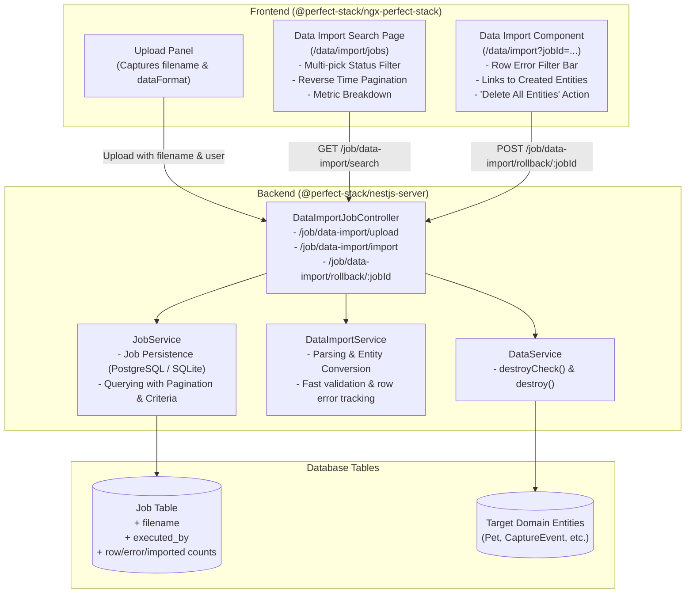

# Implementation Plan: Data Import Expansion & Test Environment Isolation

## 1. Overview & Objectives

This initiative enhances the **Data Import** feature in `@perfect-stack` to enable long-term traceability and management of data import workflows. 

### Key Capabilities to Deliver:
1. **Side-Mission (Port Isolation)**: Reconfigure the **Vet Clinic** and **test-server** test environments in `perfect-stack` to use dedicated, non-conflicting port numbers (`3180` / `4280`) so they can run alongside CARMON (`3080` / `4200` / `4010`) without collisions.
2. **Job Entity & Schema Expansion**: Track the executing user (`person_name`), original filename (`filename`), target entity (`data_format`), and structured row counts (`row_count`, `imported_count`, `error_count`, `valid_count`, `skipped_count`).
3. **Dedicated Data Import Search Page**: A dedicated search and history page (`/data/import/jobs` or `/data/import/search`) displaying reverse chronological history, pagination, multi-pick status filter (to exclude validating jobs by default), and summary metrics.
4. **Interactive Past Job Loading**: Deep-link into `/data/import?jobId=<ID>` to inspect raw rows, view proposed/actual entity payloads, and jump directly to created entities.
5. **Safe Entity Rollback / Bulk Delete**: Ability to delete all entities generated by an import job with strict relationship/integrity checks (`destroyCheck`).
6. **Error Review Filtering**: Row filtering (`All`, `Errors Only`, `Imported`, `Skipped`) on the Data Import grid to easily isolate and review invalid rows in large spreadsheets.

---

## 2. Architecture & Data Flow

---

## 3. Phased Implementation Plan

### Phase 0: Side-Mission — Reconfigure Ports for Test Environment Isolation

To ensure automated regression tests and development servers can run smoothly without clashing with CARMON's local processes:

| Application | Current Port | New Isolated Port | Configuration Files to Update |
| :--- | :--- | :--- | :--- |
| **CARMON Server** | `3080` | `3080` (Unchanged) | N/A |
| **CARMON Client** | `4200` | `4200` (Unchanged) | N/A |
| **CARMON Mock DOCMon** | `4010` | `4010` (Unchanged) | N/A |
| **Vet Clinic Backend Server** | `3080` | **`3180`** | `testing/vet-clinic/server/local.env` `testing/vet-clinic/server/src/main.ts` `testing/vet-clinic/support/server-helper.ts` `testing/vet-clinic/support/static-server.ts` `testing/vet-clinic/client/proxy.conf.json` `angular-workspace/projects/vet-clinic-client/proxy.conf.json` |
| **Vet Clinic Frontend / SPA** | `4200` | **`4280`** | `angular-workspace/angular.json` (`serve.options.port`) `testing/vet-clinic/support/server-helper.ts` `testing/vet-clinic/support/static-server.ts` `testing/vet-clinic/support/world.ts` `testing/README.md` |
| **Test Server (`test-server`)** | In-Memory / Default | **`3181`** | `testing/test-server/` (set environment port fallback if HTTP listeners are used) |

**Verification**: Run a sample smoke test in `testing/vet-clinic` (`npm test`) while ensuring no conflict occurs if CARMON is listening on `3080` / `4200`.

---

### Phase 1: Entity & Database Schema Enhancements (`Job`)

1. **Update `Job.json` Meta Entity** in both `perfect-stack/testing/vet-clinic/meta/entities/Job.json` and `carmon-webapp/capture-server/meta-capture/entities/Job.json`:
   - `filename` (`Text`): Original name of the uploaded CSV/file.
   - `executed_by` (`Text`): Full name or email of the person who ran the job.
   - `data_format` (`Text`): The data format/mapping key (e.g., `Pet`, `Bird5Min`, `Bioweb`).
   - `row_count` (`Integer`): Total rows in the input file.
   - `imported_count` (`Integer`): Total records created in the database.
   - `error_count` (`Integer`): Total rows with validation or conversion errors.
   - `valid_count` (`Integer`): Total valid rows.
   - `skipped_count` (`Integer`): Total skipped rows (blank/duplicate).
   - Add new status values to `enumeration` if appropriate (`Submitted`, `Processing`, `Completed`, `Error`, `RolledBack`).
2. **Synchronize Schema**: Perfect-Stack's automatic schema sync (`syncMetaModelWithDatabase(alter: true)`) will automatically add these columns to the `"Job"` table without manual SQL migrations.
3. **Update TypeScript Models**:
   - `Job` in `perfect-stack/nestjs-server/libs/nestjs-server/src/job/job.model.ts`
   - `Job` in `perfect-stack/angular-workspace/projects/ngx-perfect-stack/src/lib/job/job.model.ts`

---

### Phase 2: Backend Services & API Endpoints

1. **Capture User & Filename in `DataImportJobController`**:
   - In `uploadFile()`:
     - Extract original filename from `file.originalname`.
     - Extract executing user name/email from `req.user` (or fallback to dev user when `AUTH_DISABLE_FOR_DEV=true`).
     - Populate initial counts: `row_count`, `skipped_count`, etc.
   - In `importData()`:
     - Transfer filename, executed user, and updated summary counts (`imported_count`, `error_count`) to the Import Job.
2. **Search Endpoint for Data Import Jobs**:
   - Implement `GET /job/data-import/search`:
     - Parameters: `pageNumber`, `pageSize`, `status` (array/multi-value), `textSearch` (filename or executed_by), `startDate`, `endDate`.
     - Query filters: only jobs where `name IN ('Data Import - Validate', 'Data Import - Import')` (or default to only `Data Import - Import` unless user includes validating).
     - Ordering: `ORDER BY created_at DESC`.
     - Exclude the massive `data` JSON blob from the search query result set to keep payloads fast and lightweight; return lightweight `JobSummaryDto`.
3. **Safe Rollback / Delete Endpoint**:
   - Implement `POST /job/data-import/rollback/:jobId`:
     - Loads the job and deserializes `data.importedEntityList` and `data.dataFormat`.
     - Maps `dataFormat` to `metaEntityName`.
     - **Pre-check**: For each entity ID, invoke `dataService.destroyCheck(metaEntityName, entityId)`. If any entity has downstream relationships, abort and return a structured 409 Conflict with details of blocking records.
     - **Execution**: If all checks pass, delete entities in a transaction (or batch) using `dataService.destroy()`.
     - **Update Job**: Update job status to `'RolledBack'`, update `result_summary`, and clear/mark `data.importedEntityList`.

---

### Phase 3: Frontend Data Import Search Page

1. **Create `DataImportSearchComponent`**:
   - Located at: `projects/ngx-perfect-stack/src/lib/data/data-import/data-import-search/`
   - Route: `/data/import/jobs` (and link between `/data/import` and `/data/import/jobs` via a sub-navigation bar / tabs).
2. **Search Criteria Bar**:
   - Multi-select status dropdown with pill badges (`Completed`, `Error`, `Processing`, `RolledBack`, `Validating`). Default selection excludes `Validating` to focus on actual imports.
   - Date range selector (from date / to date).
   - Filename / Executed By search input.
   - Search & Reset buttons.
3. **Results Table**:
   - **Date/Time**: Formatted localized timestamp (`yyyy-MM-dd HH:mm:ss`), sorted reverse-chronologically.
   - **Executed By**: User name or badge.
   - **Filename**: Original file name.
   - **Data Format**: Format label.
   - **Status**: Color-coded badge (`Completed` = green, `Error` = red, `Processing` = blue, `RolledBack` = secondary).
   - **Row Metrics Breakdown**: Compact visual badge summary (`Total: X | Imported: Y | Errors: Z | Skipped: S`).
   - **Actions**:
     - **View / Open**: Opens `/data/import?jobId=<ID>` to view full details.
     - **Rollback (Delete Imported Entities)**: If status is `Completed` and imported count > 0, shows a "Rollback" action with confirmation dialog.
4. **Pagination**:
   - Clean pagination control (`< 1 2 3 4 5 >`) with page size selector (10, 25, 50).

---

### Phase 4: Job Interaction & Error Review Enhancements

1. **Quick Row Filter Bar on Data Import Grid**:
   - Add a segmented filter button bar above the data table in `data-import.component.html`:
     - **`All (N)`**
     - **`Errors Only (E)`**
     - **`Imported (I)`**
     - **`Skipped (S)`**
   - Clicking `Errors Only` instantly hides valid rows so users with 5,000-row files can immediately inspect the specific rows that failed.
2. **Navigation to Created Entities**:
   - When viewing an imported job, the Row column already renders links to `/data/<Entity>/view/<id>`.
   - Add an action button in the summary panel: **"View All Created Entities"** (navigates to `/data/<Entity>/search` or opens a quick modal with the list of created IDs).
3. **Interactive Rollback Modal**:
   - Add a "Delete All Entities" button to `DataImportComponent` when viewing a completed import job.
   - Confirmation dialog clearly warning: *"This will permanently delete all X records created by this import."*
   - Shows progress spinner during deletion and updates UI to reflect the `RolledBack` state.

---

### Phase 5: Testing, Documentation & Validation

1. **Port Isolation Verification**:
   - Run `testing/vet-clinic` cucumber suite on port `3180`/`4280` while CARMON runs on `3080`/`4200`. Verify zero port clashes.
2. **Unit / Integration Tests**:
   - Test `JobService` search and pagination queries.
   - Test rollback endpoint: verify successful deletion when no relations exist, and verify graceful conflict rejection when downstream records are linked.
3. **E2E / UI Scenarios**:
   - Verify file upload tracks filename, user, and row count metrics.
   - Verify search page lists past jobs with multi-select status and pagination.
   - Verify loading a past job restores full table state, allows filtering by errors, and supports rolling back imported entities.
4. **Documentation**:
   - Update `carmon-webapp/docs/Architecture.md` and `perfect-stack/docs/Architecture.md` per the living documentation rule in `AGENTS.md`.

---

## 4. Work Breakdown & Sequencing

```mermaid
gantt
    title Data Import Expansion Execution Sequence
    dateFormat  X
    axisFormat %d

    section Phase 0
    Reconfigure Vet Clinic & test-server Ports :0, 2
    Verify Port Isolation & Regression Tests   :2, 3

    section Phase 1 & 2
    Expand Job.json & TS Models                :3, 4
    Enhance DataImportJobController & Service  :4, 6
    Build Safe Rollback Endpoint & Conflict Logic :6, 8

    section Phase 3 & 4
    Build DataImportSearchComponent & Routes   :8, 11
    Add Row Filter Bar & Error Inspection       :11, 13
    Integrate Rollback Dialog & Deep Linking   :13, 15

    section Phase 5
    End-to-End Verification & Docs Sync        :15, 17
```

